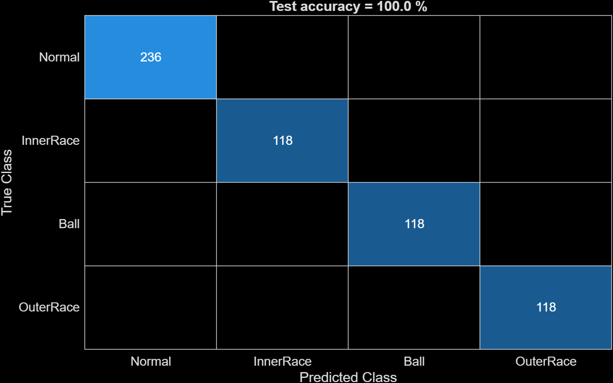
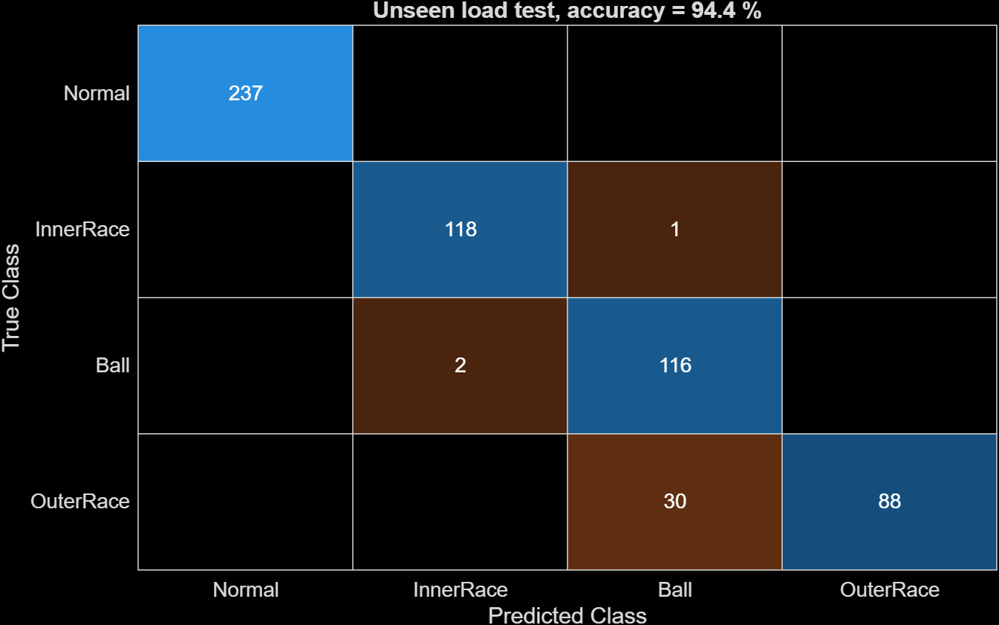
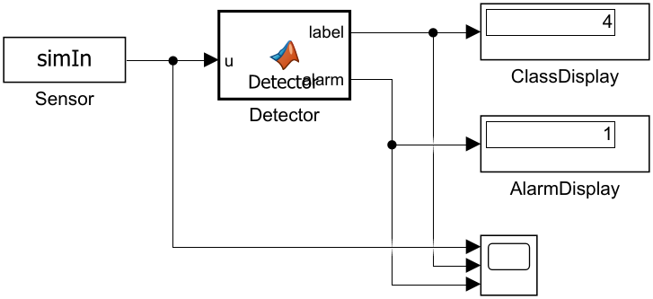
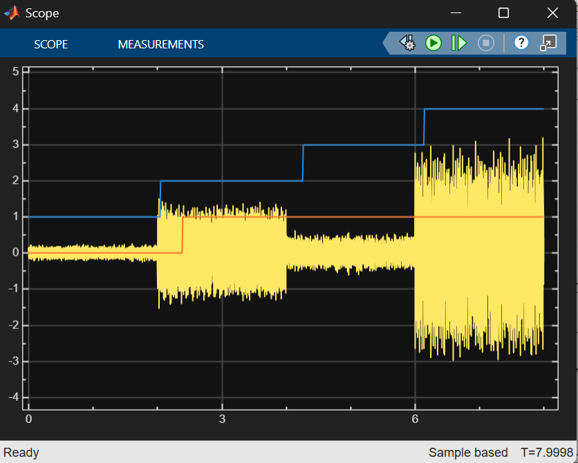
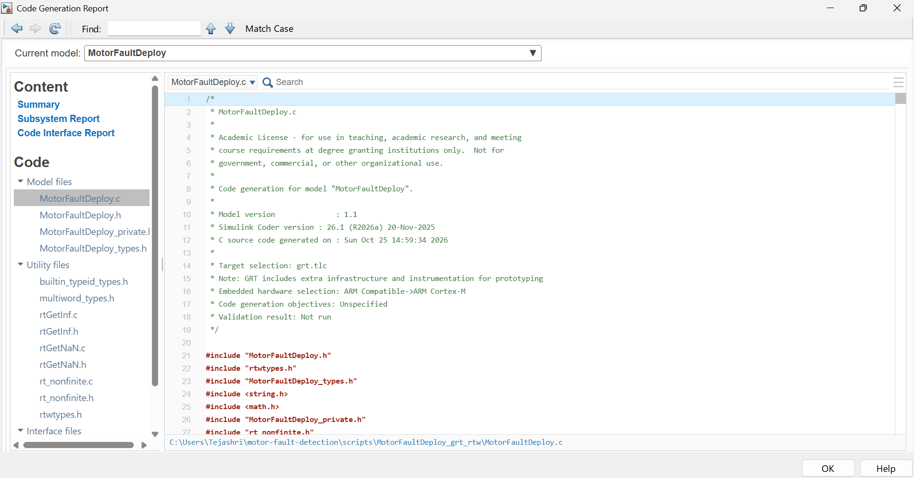

# Motor Fault Detection with Simulink and Machine Learning

Bearing fault detection from vibration data, built with MATLAB, Simulink and the Statistics and Machine Learning Toolbox. The detector runs in Simulink, raises an alarm when faults persist, and is set up for C code generation on an ARM Cortex-M target (the architecture of the STM32H743 on the NUCLEO-H743ZI2).

**Author:** Tejashri | **Level:** Bachelor's | **MATLAB:** R2026a
**Challenge project:** MathWorks Challenge Project 253

## 1. Problem
Unexpected motor failures cause downtime. Bearings are a common failure point, and their damage shows up in vibration. This project classifies a motor's condition from vibration data and raises an alarm when a fault is detected.

## 2. Dataset
CWRU Bearing Data Center (Case Western Reserve University), 12 kHz drive-end accelerometer, 28 files.

| Class | Files (12k Drive End) | Windows |
|---|---|---|
| Normal | 97-100 | 828 |
| InnerRace | 105-108, 169-172 | 473 |
| Ball | 118-121, 185-188 | 472 |
| OuterRace | 130-133, 197-200 | 472 |

Fault diameters are 0.007" and 0.014", at motor loads of 0-3 HP. The data is not stored in this repo. See `data/README.md`.

## 3. Method
```
CWRU signal -> 2048-sample windows -> 10 features -> bagged trees -> alarm logic
```
- **Window:** 2048 samples (about 0.17 s at 12 kHz).
- **Features (10):** mean, standard deviation, RMS, peak, kurtosis, skewness, crest factor, band power in 1-1000, 1000-3000 and 3000-5500 Hz.
- **Classifier:** bagged decision trees (50 trees, max 40 splits).
- **Alarm:** raised after 3 consecutive faulty windows, which filters out single-window glitches (detection delay of about 0.4-0.5 s).

## 4. Results
| Test | Accuracy |
|---|---|
| Random split by file (7 held-out files, 590 windows) | 100% |
| Unseen load (train 0-2 HP, test 3 HP, 592 windows) | 94.4% |

The split is by file, not by window, to avoid leakage between nearly identical windows.




In the unseen-load test, 30 of 118 Outer Race windows were predicted as Ball. No fault window was classified as Normal, and no Normal window was flagged as a fault.

## 5. Simulink model
`simulink/MotorFaultDetector.slx` plays a signal (Normal, Inner Race, Ball, Outer Race, 2 s each) into a MATLAB Function block (`scripts/motorDetector.m`) that outputs the class and the alarm.




The demo signal uses 3 HP files that are also in the training data, so it demonstrates the pipeline and is not an accuracy test. The accuracy numbers come from section 4.

## 6. Embedded deployment
- `scripts/step4_generate_code.m` builds `MotorFaultDeploy.slx` (input port: acceleration, outputs: class and alarm) and generates C code for an ARM Cortex-M target. The generated code is in `codegen/`.



- `bandpower` is not supported for code generation, so `scripts/bandPow.m`, an FFT-based equivalent, is used. On a test signal it differs from `bandpower` by about 1.4%.
- **Simulation only.** The NUCLEO-H743ZI2 board and the LIS3DH sensor were not used. The STM32 toolchain (STM32CubeMX) could not be downloaded, so the generic ARM Cortex-M target was used instead of the board-specific one.
- The LIS3DH samples at up to about 5 kHz, but the model was trained at 12 kHz. A hardware test would need retraining at the sensor's sampling rate.
- Alerts (LED, buzzer, notifications) are represented in simulation by the alarm signal.

## 7. How to run
Toolboxes: MATLAB, Simulink, Statistics and Machine Learning, Simulink Coder (Embedded Coder for `grt.tlc`).
1. Download the CWRU files (see `data/README.md`) and edit `root` in the scripts.
2. `scripts/step1_extract_features.m`
3. `scripts/step2_train_classifier.m`
4. `scripts/step2b_load_generalization.m`
5. `scripts/step3_build_simulink.m` (needs `motorDetector.m` and `bandPow.m`)
6. `scripts/step4_generate_code.m`

## 8. Limitations and future work
- Only bearing faults are covered. Rotor imbalance, shaft misalignment and electrical faults (open or short circuit) are future work, and would need other datasets or a Simulink motor model.
- One drive-end sensor, one motor rig, and 28 recordings.
- No hardware test. Future work includes the NUCLEO-H743ZI2 with an LIS3DH, retraining at the sensor's sampling rate, and real LED or buzzer alerts.

## 9. Use of generative AI
I used Claude (Anthropic) as an assistant throughout the project.

**What AI helped with**
- Planning the pipeline and the two-day schedule.
- Writing first drafts of the MATLAB scripts (feature extraction, training, validation, Simulink model builder, code generation).
- Debugging errors (MATLAB file naming, model path, Git pushes, unsupported `bandpower` for code generation).
- Suggesting the extra unseen-load test and drafting this README.

**What I did myself**
- Chose the topic scope, switched datasets (MAFAULDA was too large, so I moved to CWRU), and downloaded the data.
- Ran all scripts, built and ran the Simulink model, and attempted the STM32 toolchain setup.
- Checked the results (confusion matrices, scope output) and decided what to report, including the limitations.
- Managed the repository.

All AI-written code was run and checked before use. Errors were reported back and fixed in the same way.

## 10. Repository structure
```
data/       how to get the dataset (data not included)
scripts/    MATLAB scripts and detector functions
models/     feature table and trained models
simulink/   MotorFaultDetector.slx, MotorFaultDeploy.slx
codegen/    generated C code
results/    figures and screenshots
docs/       report
```
