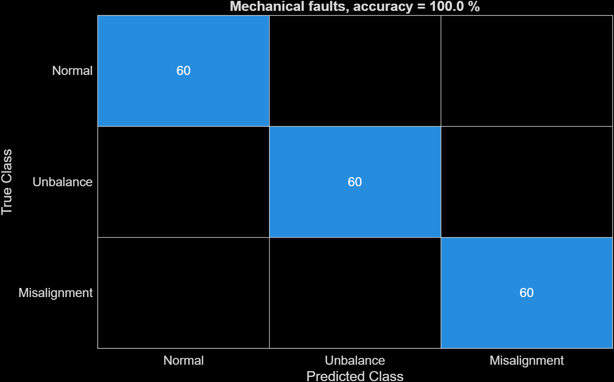
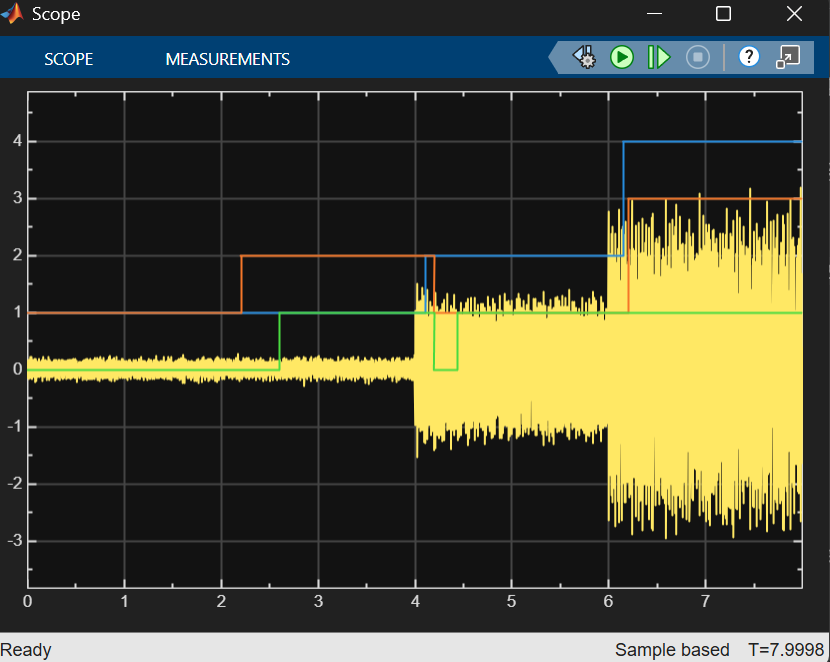
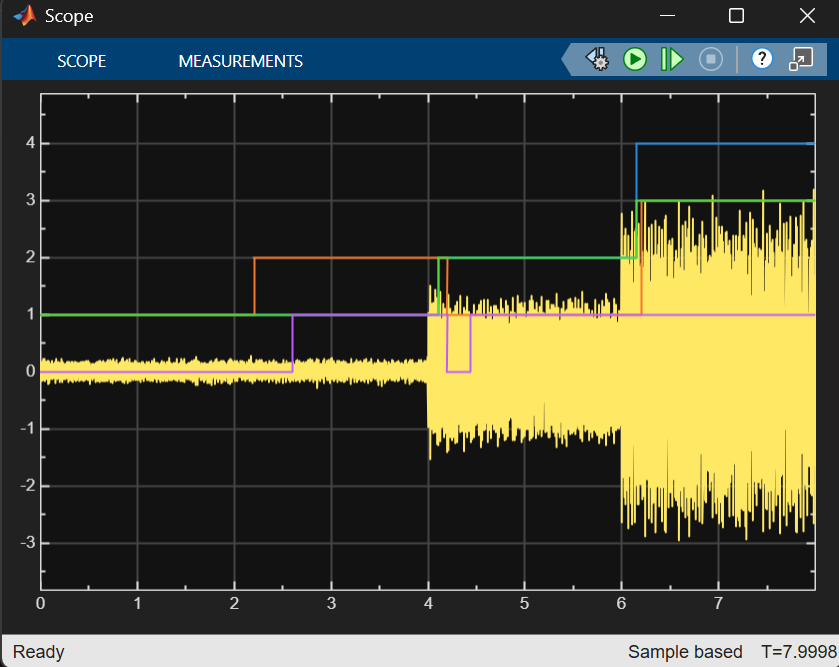
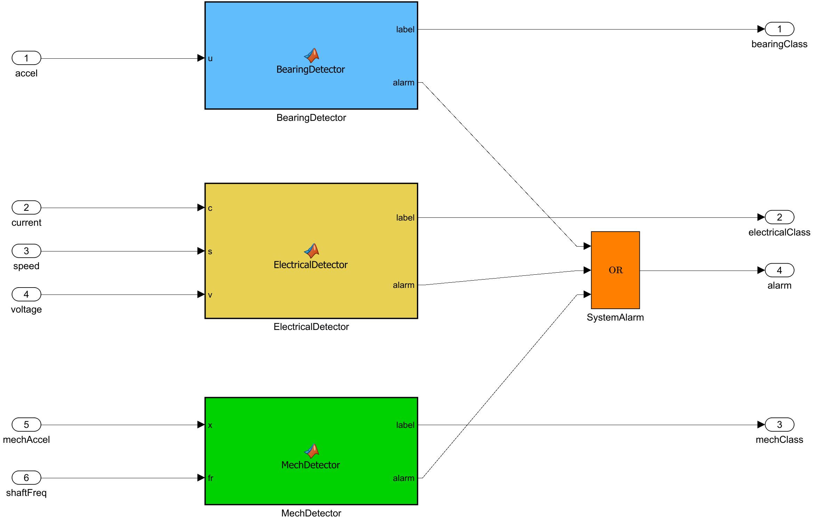

# Motor Fault Detection with Simulink and Machine Learning

A fault detection system for electric motors, built with MATLAB and Simulink. Three small classifiers watch different signals (vibration and motor current), and one combined alarm goes on when any of them sees a fault. C code is generated for an ARM Cortex-M device type, the architecture of the STM32H743 on the NUCLEO-H743ZI2.

Author: Tejashri  
Level: Bachelor's
MATLAB: R2026a
Challenge: MathWorks Challenge Project 253

## 1. Problem

Unexpected motor failures cause downtime. Faults show up early in the vibration and in the electrical signals of a motor. This project classifies the condition of a motor from those signals and raises an alarm when a fault persists.

Faults covered:
- Bearing faults: inner race, ball, outer race
- Rotor imbalance (unbalance)
- Shaft misalignment
- Electrical faults: open circuit, short circuit

## 2. System overview

There are three separate detectors. Each one has its own signal, features and classifier.

1. Bearing detector: vibration from the CWRU dataset. Classes: Normal, InnerRace, Ball, OuterRace.
2. Electrical detector: armature current, speed and supply voltage from a simulated DC motor. Classes: Healthy, OpenCircuit, ShortCircuit.
3. Mechanical detector: simulated rotor vibration plus the shaft frequency. Classes: Normal, Unbalance, Misalignment.

Each detector decides once per window and raises its alarm after 3 consecutive faulty windows. This filters out single-window glitches. The system alarm is the OR of the three detector alarms.

The three detectors are not one model. They use different sensors and data, and training one classifier on mixed sources would let it learn which source it is looking at instead of the fault.

## 3. Data

Bearing faults (real data): CWRU Bearing Data Center, Case Western Reserve University. 12 kHz drive-end accelerometer, 28 files: Normal (97-100), Inner Race (105-108, 169-172), Ball (118-121, 185-188) and Outer Race (130-133, 197-200). Fault diameters are 0.007" and 0.014", at motor loads of 0-3 HP. Windows of 2048 samples (about 0.17 s) give 2,245 windows: Normal 828, InnerRace 473, Ball 472, OuterRace 472. The data is not stored in this repo (see `data/README.md`).

Electrical faults (simulated): a DC motor model (armature current and speed equations) with 40 runs per class at 12 kHz. Parameters vary by 8%, and supply voltage and load torque are random. Sensor noise is added. Open circuit is modelled as short intermittent gaps in the armature current. Short circuit is modelled as 10-30% of the winding turns being shorted, which lowers resistance, inductance and back-EMF. Windows of 2400 samples (0.2 s) give 400 windows per class.

Unbalance and misalignment (simulated): rotor vibration built from the shaft-frequency harmonics, with random shaft speed (20-50 Hz), severity, sensor gain and noise. Unbalance has a strong 1x component that grows with speed squared. Misalignment has a strong 2x component with raised 1x and 3x. 40 runs per class with 6 windows each of 4096 samples (about 0.34 s) give 240 windows per class.

Real data for imbalance and misalignment was looked for, but the public datasets found were too large for the available time or needed a paid subscription. That is why these two faults are simulated.

## 4. Features

Bearing detector (10 features per window): mean, standard deviation, RMS, peak, kurtosis, skewness, crest factor, and band power in 1-1000, 1000-3000 and 3000-5500 Hz.

Electrical detector (10 features): current mean, standard deviation, RMS, peak, kurtosis, skewness and crest factor; speed mean and standard deviation; speed divided by supply voltage.

Mechanical detector (10 features): standard deviation, RMS, peak, kurtosis, crest factor, the amplitude at 1x, 2x and 3x of the shaft frequency, and the ratios 2x/1x and 3x/1x.

All classifiers are bagged decision trees (50 trees, up to 40 splits).

## 5. Results

All splits are made by file or by simulation run, not by window. Windows from the same recording look almost identical, and a random window split would inflate the accuracy.

Bearing faults (real CWRU data):
- Random split by file (7 held-out files, 590 windows): 100%.
- Unseen load (train on 0-2 HP, test on 3 HP, 592 windows): 94.4%, which is 559 of 592 correct. 30 of the 118 Outer Race windows were predicted as Ball. No fault window was classified as Normal, and no Normal window was flagged as a fault.

Electrical faults (simulated data):
- Split by simulation run (30 held-out runs, 300 windows): 93.3%.

Unbalance and misalignment (simulated data):
- Split by simulation run (30 held-out runs, 180 windows): 100%.
- Unseen shaft speed (train below 40 Hz, test at 40 Hz and above): 100%.

The simulated results show that the pipeline works. They are not real-world accuracies, because the simulated signatures are idealized.

Confusion matrices:

## 6. Simulink model

`simulink/MotorFaultSystem.slx` runs all three detectors on a demo scenario of 2 s segments:
- 0-2 s: everything healthy.
- 2-4 s: electrical open circuit.
- 4-6 s: bearing inner race and unbalance.
- 6-8 s: bearing outer race, electrical short circuit and misalignment.

Each detector is a MATLAB Function block. The alarm turns on about 0.5 s (bearing), 0.6 s (electrical) and 1 s (mechanical) after a fault starts, because each needs 3 consecutive faulty windows. The alarm drops briefly around 4.2-4.45 s: the electrical fault has ended, but the bearing detector has not yet seen 3 faulty windows.

The bearing demo segments use 3 HP CWRU files that are also part of the training data, so the demo shows that the pipeline works and is not an accuracy test. The accuracy numbers are in section 5.

## 7. Code generation (embedded deployment)

`scripts/step4_generate_code.m` builds `simulink/MotorFaultDeploy.slx` and generates C code with Simulink Coder (`grt.tlc`) for an ARM Cortex-M device type, the architecture of the STM32H743 on the NUCLEO-H743ZI2.
- Inputs: acceleration, current, speed, voltage, mechanical acceleration, shaft frequency.
- Outputs: bearing class, electrical class, mechanical class, and the combined alarm.
- Generated code: `codegen/MotorFaultDeploy_grt_rtw/`.

Design points for embedded use:
- `bandpower` is not supported for code generation, so `scripts/bandPow.m`, an FFT-based equivalent, is used. On a test signal it differed from `bandpower` by about 1.4%.
- The classifiers are saved with `saveLearnerForCoder` and loaded with `loadLearnerForCoder` inside the detector functions.

This is a simulation-only project. The NUCLEO-H743ZI2 board and the LIS3DH sensor were not used. The STM32 toolchain (STM32CubeMX) could not be downloaded, so the generic Cortex-M target was used instead of the board-specific one. The LED, buzzer and notification outputs are represented in simulation by the alarm signal.

## 8. How to run

Requirements: MATLAB R2026a, Simulink, Statistics and Machine Learning Toolbox, Simulink Coder.

1. Download the CWRU files (see `data/README.md`) and edit the `root` line in the scripts that have one.
2. `scripts/step1_extract_features.m` (bearing features)
3. `scripts/step2_train_classifier.m` (bearing classifier and confusion matrix)
4. `scripts/step2b_load_generalization.m` (unseen-load test)
5. `scripts/step3_build_simulink.m` (bearing detector model, creates `motorFaultModelNum.mat`)
6. `scripts/step5_electrical_faults.m` (simulated electrical data and classifier)
7. `scripts/step6_build_combined.m` (creates `electricalModelNum.mat`)
8. `scripts/step7_mechanical_faults.m` (simulated mechanical data, creates `mechModelNum.mat`)
9. `scripts/step8_build_full_system.m` (three-detector Simulink model)
10. `scripts/step4_generate_code.m` (C code generation also saves results/simulink_model_deploy.png)

Detector functions used by the models: `motorDetector.m`, `electricalDetector.m`, `mechanicalDetector.m`, `bandPow.m`, `mechFeatures.m`. Do not run these directly.

## 9. Limitations and future work

- Only the bearing data is real. Electrical, unbalance and misalignment data are simulated with simplified signatures, so their accuracies need validation on real machines.
- The three detectors are separate and use different sensors. A real system needs a vibration sensor, current and speed sensors, and a shaft-speed measurement. The mechanical detector takes the shaft frequency as an input, which on hardware would come from a tachometer or an estimate.
- CWRU covers one motor rig and 28 recordings. The Outer Race class is the weak point on unseen loads.
- The model was trained at 12 kHz, but a LIS3DH accelerometer samples at up to about 5 kHz. A hardware test would need retraining at the sensor's rate.
- No hardware test was done. Future work: test on the NUCLEO-H743ZI2 with an LIS3DH, real LED or buzzer alerts, and notifications.
- The simulated faults are generated with MATLAB equations and a small DC motor model. A more physical model with Simscape blocks (bearing, flexible shaft, variable damper) is future work.
- Real imbalance and misalignment data could replace the simulated data. One candidate is the IEEE DataPort Multi-Speed Raw Triaxial Vibration Dataset (about 3.2 kHz, close to the LIS3DH range), which needs a subscription.

## 10. Use of generative AI

I used Claude (Anthropic) as an assistant throughout the project.

What the AI helped with:
- Planning the pipeline and the schedule.
- Writing first drafts of the MATLAB scripts and detector functions.
- Designing the simulated DC motor and rotor vibration fault models.
- Debugging errors (MATLAB naming rules, model paths, Git pushes, the `bandpower` code generation limitation, Simulink block library names).
- Suggesting the unseen-load test and drafting this README.

What I did myself:
- Chose the project scope, and switched datasets when the first one (MAFAULDA) was too large.
- Downloaded the data, ran every script, and built and ran the Simulink models.
- Tried the STM32 toolchain setup, and chose the generic Cortex-M target when the download failed.
- Checked the results (confusion matrices and scope output) and decided what to report, including the limitations.
- Managed the repository.

All AI-written code was run and checked before use. Errors were reported back and fixed the same way.

## 11. Repository structure

- `data/`: how to get the dataset (the data itself is not included)
- `scripts/`: MATLAB scripts and detector functions
- `models/`: feature tables and trained models
- `simulink/`: `MotorFaultDetector.slx`, `MotorFaultSystem.slx`, `MotorFaultDeploy.slx`
- `codegen/`: generated C code
- `results/`: figures and screenshots
- `docs/`: report

## 12. Data and credits

- CWRU Bearing Data Center, Case Western Reserve University (bearing vibration data).
- Electrical and mechanical fault data were generated by the scripts in this repository.
